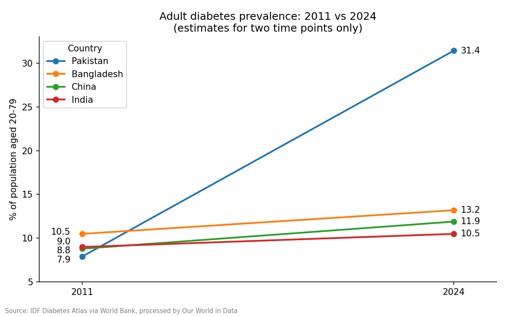
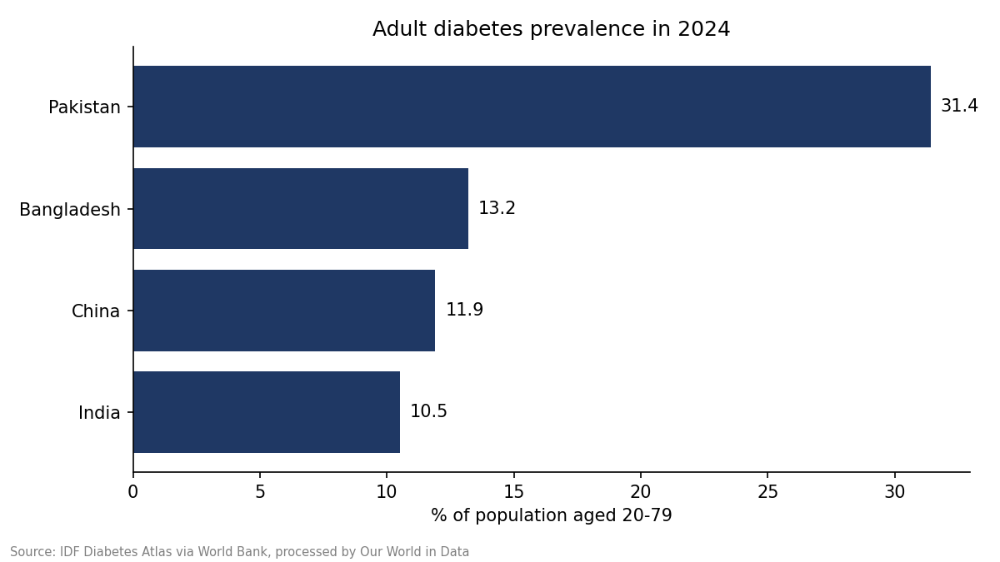

# Adult diabetes prevalence: Pakistan, China, India and Bangladesh (2011 vs 2024)

A small descriptive analysis of public diabetes estimates, using Python (pandas, matplotlib).

## Question
How do estimates of adult diabetes prevalence in Pakistan compare with China, India and Bangladesh in 2011 and 2024?

## Data
- Indicator: Share of people with diabetes (% of population aged 20-79).
- Source: International Diabetes Federation (Diabetes Atlas), via World Bank World Development Indicators, processed by Our World in Data.
- Download: https://ourworldindata.org/grapher/diabetes-prevalence ("Download full data")
- The full file has three years (2000, 2011, 2024), and 2000 is missing for most countries. I compared 2011 and 2024.
- `diabetes_selected_rows.csv` holds the 8 rows used. The last column gives each row's position in the downloaded file, so they can be checked.

## Method
1. Loaded the rows and checked for missing values and for exactly two rows per country.
2. Calculated the difference between 2024 and 2011 for each country.
3. Plotted the two time points and a 2024 comparison.

## Results

| Country | 2011 (%) | 2024 (%) | Change (percentage points) |
|---|---|---|---|
| Pakistan | 7.9 | 31.4 | +23.5 |
| Bangladesh | 10.5 | 13.2 | +2.7 |
| China | 8.8 | 11.9 | +3.1 |
| India | 9.0 | 10.5 | +1.5 |

Change = 2024 value minus 2011 value.

## Findings
- Pakistan has the highest estimate in 2024 (31.4%), compared with 10.5-13.2% in the other three countries.
- Pakistan's estimate rose by 23.5 percentage points. The other three rose by 1.5 to 3.1 points.
- I could not confirm why Pakistan's change is so much larger. It may partly reflect differences in survey sources or methods between estimates, not only a real increase.

## Limitations
- Only two time points are compared, so this does not show a trend.
- Estimates are modelled, and sources and methods may differ between years and countries.
- Some values for 2000 in the full file are exactly 0 and look like errors, so 2000 was excluded.
- Country-level data cannot show causes or individual risk.
- This is a descriptive analysis, not a research study.

## Files
- `analysis.py`: full script
- `diabetes_selected_rows.csv`: the 8 data rows used
- `change_table.csv`: results table
- `chart1_2011_vs_2024.png`, `chart2_2024.png`: charts

## Author and transparency
Agha Shahzad Hussain. Independent learning project after the Google Data Analytics Professional Certificate.
I selected the question and data, and checked the values against the downloaded file.
